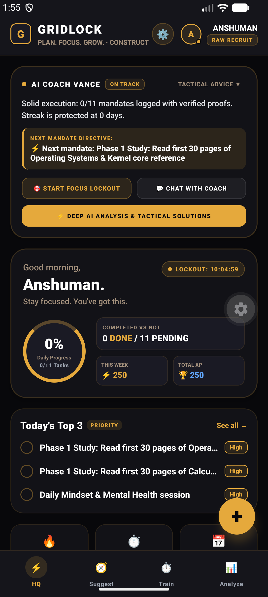
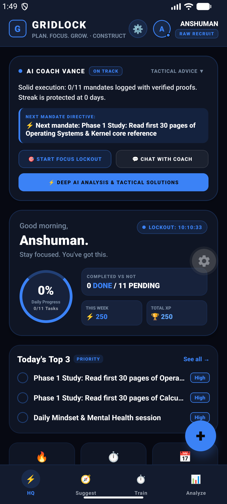
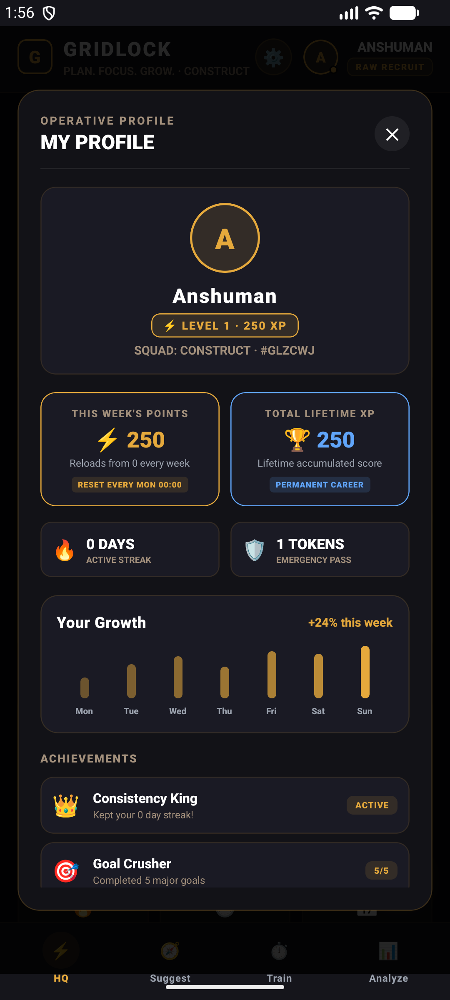
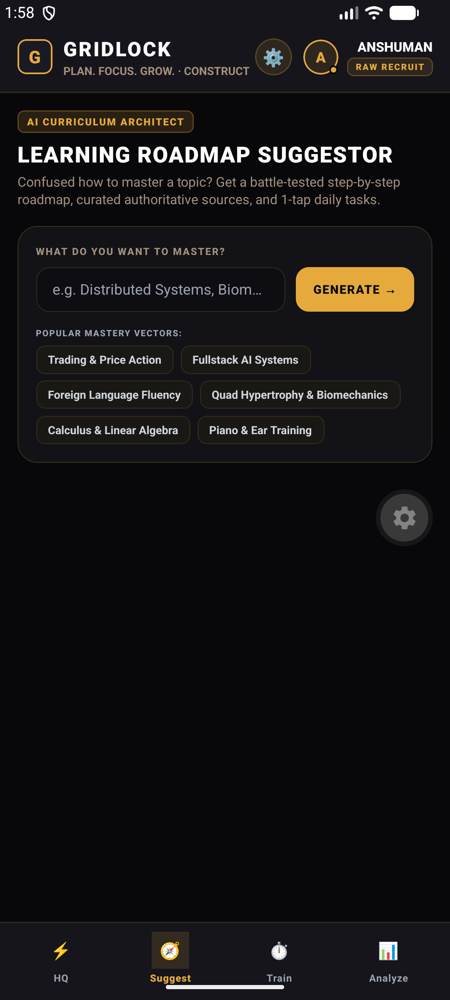
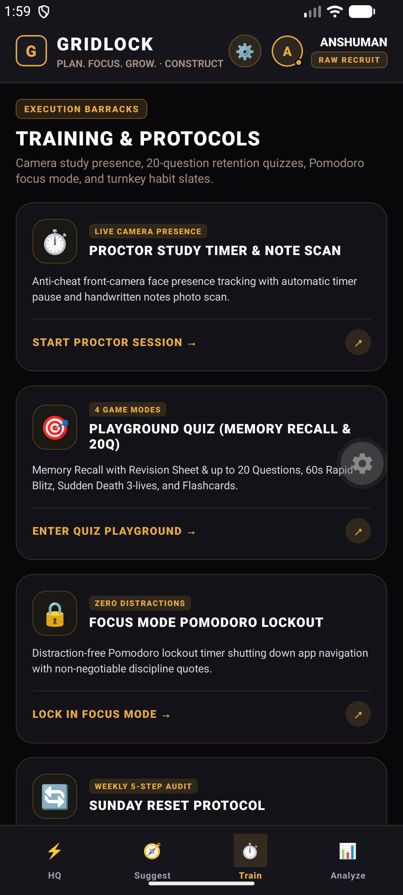
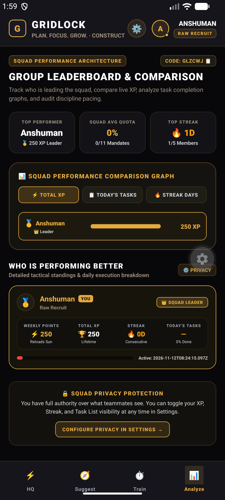
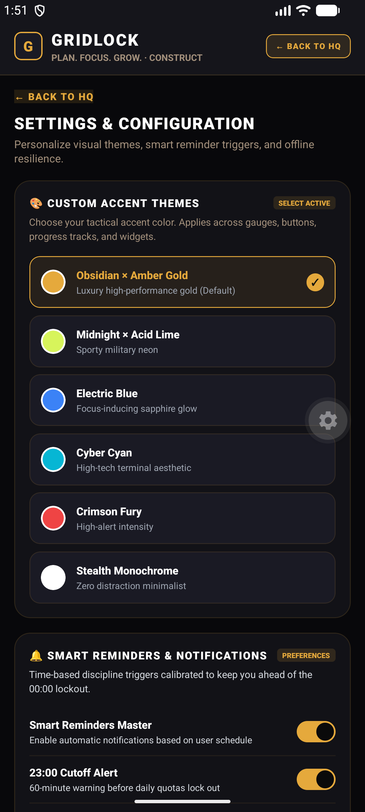
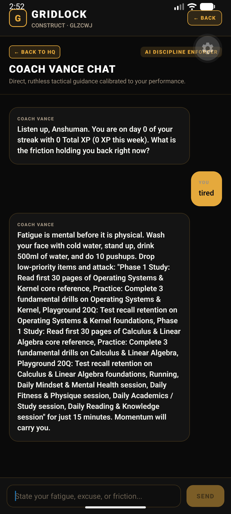

<div align="center">

# ⚡ GRIDLOCK
### *Plan. Focus. Grow.*

**Autonomous Discipline Protocol & AI Accountability Mobile Architecture**

[](https://reactnative.dev/)
[](https://expo.dev/)
[](https://www.typescriptlang.org/)
[](https://ai.google.dev/)
[](https://supabase.com/)
[](LICENSE)

<br/>

*An uncompromising mobile system engineered to eliminate procrastination, enforce daily execution through multimodal AI vision audits, and foster squad competition.*

</div>

---

## 📱 Visual Showcase & Application Tour

<div align="center">
<table>
  <tr>
    <td align="center" width="50%">
      <b>⚡ HQ Command Center</b><br/>
      <i>Lockout countdown, progress ring, Vance widget & Top 3</i><br/><br/>
      
    </td>
    <td align="center" width="50%">
      <b>🎨 Dynamic Tactical Themes</b><br/>
      <i>Instant reactive switching to Electric Blue palette</i><br/><br/>
      
    </td>
  </tr>
  <tr>
    <td align="center" width="50%">
      <b>👤 Operative Dossier (Profile)</b><br/>
      <i>Your Growth daily trend chart, Achievements & Dual-XP</i><br/><br/>
      
    </td>
    <td align="center" width="50%">
      <b>🧭 AI Learning Roadmap Suggestor</b><br/>
      <i>Curriculum architect with sources & 1-tap task sync</i><br/><br/>
      
    </td>
  </tr>
  <tr>
    <td align="center" width="50%">
      <b>⏱️ Training & Execution Hub</b><br/>
      <i>Proctor study timer, Quiz playground & Pomodoro lockout</i><br/><br/>
      
    </td>
    <td align="center" width="50%">
      <b>📊 Squad Performance Architecture</b><br/>
      <i>Live group leaderboard & multi-metric performance comparison</i><br/><br/>
      
    </td>
  </tr>
  <tr>
    <td align="center" width="50%">
      <b>🎨 6 Tactical Accent Palettes</b><br/>
      <i>Obsidian Gold, Acid Lime, Electric Blue, Cyan, Crimson, Mono</i><br/><br/>
      
    </td>
    <td align="center" width="50%">
      <b>💬 AI Coach Vance Terminal</b><br/>
      <i>Contextual problem diagnostic & surgical action protocol</i><br/><br/>
      
    </td>
  </tr>
</table>
</div>

---

## 🏛️ System Architecture

The following diagram illustrates the data flow, AI verification pipeline, and state synchronization across the GRIDLOCK architecture:

```mermaid
flowchart TD
    Operative([👤 Operative]) --> UI[📱 Mobile Application Shell (App.tsx)]
    
    subgraph CorePillars [Core Operational Pillars]
      UI --> HQ[⚡ HQ Command Center]
      UI --> Sugg[🧭 AI Roadmap Suggestor]
      UI --> Train[⏱️ Execution Barracks]
      UI --> Anal[📊 Squad Analytics Hub]
    end

    subgraph VerificationEngine [Multimodal AI Verification Engine]
      HQ --> Proof[📸 Photo Proof Submission]
      Proof --> GeminiAudit[🤖 Google Gemini 1.5 Flash Vision]
      GeminiAudit --> Audited{Confidence >= 75%?}
      Audited -- Verified --> AwardXP[🏆 Award 100 XP + Update Streak]
      Audited -- Insufficient --> FlagRetry[⚠️ Flag Mandate & Require Audit Retake]
    end

    subgraph IntelligenceEngine [Adaptive NLP & Curriculum]
      Sugg --> GeminiRoadmap[🧠 Gemini Curriculum Architect]
      GeminiRoadmap --> RoadmapTasks[📋 1-Tap Daily Task Injection]
      RoadmapTasks --> HQ
      Train --> QuizGen[🎯 Domain-Adaptive 20Q Quiz Engine]
      HQ --> Vance[🤖 AI Coach Vance Diagnostic]
    end

    subgraph Persistence [Persistence & Cloud Layer]
      AwardXP --> LocalStore[(💾 Device AsyncStorage)]
      AwardXP --> CloudSync[(☁️ Supabase PostgreSQL Cloud)]
      CloudSync --> SquadLeaderboard[👥 5-Operative Squad Ranking]
      SquadLeaderboard --> Anal
    end
```

---

## 💎 Core Innovation & Differentiators

### 1. 🛡️ The "Zero Unverified Quotas" Model
Standard productivity apps rely on honor systems where users simply tap checkboxes without doing the work. **GRIDLOCK rejects unearned completion:**
- Completed mandates require **cryptographic camera or photo evidence** (e.g., opened physical textbooks, terminal output, gym equipment, trade tickets).
- **Gemini 1.5 Flash Vision** inspects the image in real time, generates an audit rationale, computes a confidence percentage, and logs the verification stamp.

### 2. ⚡ Dual-XP Scoring Economics
- **Weekly XP**: Reloads to `0` every Monday at `00:00 UTC` to eliminate runaway leaderboards and maintain intense weekly squad competition.
- **Lifetime Career XP**: Permanently accumulates across the operative's career to reflect total lifetime volume and rank advancement.

### 3. 🧠 Contextual Problem-Solving AI Coach (Vance)
Unlike static chatbots that return canned generic advice:
- Scans current pace vs remaining hours until the 00:00 midnight lockout.
- Classifies user friction (**Fatigue**, **Phone Distraction**, **Procrastination**, **Trading Tilt**, **Study Overwhelm**).
- Prescribes surgical, structured protocols with zero cognitive overhead.

### 4. 🎨 Hardware-Calibrated Reactive Theme Engine
A high-performance color architecture that updates the entire app dynamically across 6 curated palettes:
- **Obsidian × Amber Gold** (Default Luxury Performance)
- **Midnight × Acid Lime** (Tactical Neon)
- **Electric Blue** (Sapphire Deep Focus)
- **Cyber Cyan** (High-Tech Terminal)
- **Crimson Fury** (High-Alert Intensity)
- **Stealth Monochrome** (Distraction-Free Minimalist)

---

## 🛠️ Technology Stack Breakdown

| Layer | Technology | Purpose |
|---|---|---|
| **Mobile Runtime** | [React Native 0.88.1](https://reactnative.dev/) | Cross-platform high-performance native rendering engine |
| **Tooling & Bundler** | [Expo SDK 58](https://expo.dev/) | Native runtime, Metro bundler, dev tools, and permission bridges |
| **Language** | [TypeScript 5](https://www.typescriptlang.org/) | Strict type contracts across state, storage, and models |
| **AI Intelligence** | [Google Gemini 1.5 Flash](https://ai.google.dev/) | Vision verification audit, adaptive curriculum generation & NLP coaching |
| **Cloud Database** | [Supabase](https://supabase.com/) | Real-time PostgreSQL squad synchronization and multi-device persistence |
| **Local Storage** | `@react-native-async-storage` | Local hardware keychain persistence with multi-account partitioning |
| **Hardware APIs** | `expo-camera`, `expo-image-picker` | Native camera capture, album picking, and image compression |

---

## 📂 Project Organization

```
Gridlock/
├── .github/
│   ├── workflows/ci.yml        # Automated GitHub Actions TypeScript CI
│   ├── ISSUE_TEMPLATE/         # Structured Bug & Feature request templates
│   └── PULL_REQUEST_TEMPLATE.md
├── assets/                     # App icons, splash screens, and vector assets
├── docs/
│   └── screenshots/            # Showcase images embedded in documentation
├── src/
│   ├── types.ts                # TypeScript domain models (User, Task, Squad, Theme)
│   ├── theme.ts                # Unified reactive 6-palette theme tokens
│   ├── components/             # Reusable UI modules
│   │   ├── TopCoachWidget.tsx          # Real-time AI Coach Vance banner & analyzer
│   │   ├── ProofSubmissionModal.tsx    # Multimodal photo proof upload & AI verify
│   │   ├── QuickAddModal.tsx           # Rapid task creator with priority chips
│   │   └── PhoneWidgetPreview.tsx      # Homescreen widget preview
│   ├── screens/                # Modular application screens
│   │   ├── DashboardScreen.tsx         # HQ Command Center (Progress Ring, Top 3, Mandates)
│   │   ├── SuggestorScreen.tsx         # AI Learning Roadmap Suggestor
│   │   ├── TrainingHubScreen.tsx       # Execution Barracks & protocol directory
│   │   ├── AnalysisScreen.tsx          # Squad comparison & analytics hub
│   │   ├── SettingsScreen.tsx          # 6-theme switcher & privacy controls
│   │   ├── CoachScreen.tsx             # Interactive intelligent coach terminal
│   │   ├── PlaygroundScreen.tsx        # 4-mode topic-adaptive quiz simulator
│   │   ├── StudyScreen.tsx             # Camera study proctor timer
│   │   ├── FocusModeScreen.tsx         # Distraction-free lockout Pomodoro
│   │   ├── GroupLeaderboardScreen.tsx  # Detailed squad rankings & graph
│   │   ├── SundayResetScreen.tsx       # 5-step weekly operational audit
│   │   └── onboarding/                 # Multi-account auth & personalized plan generator
│   └── services/
│       ├── gemini.ts           # Multimodal Gemini Vision auditing & NLP
│       ├── storage.ts          # Local persistent key-value & profile manager
│       └── backend.ts          # Supabase cloud synchronization
├── App.tsx                     # Master app shell, auth gate & top operative dossier
├── package.json                # Project dependencies and execution scripts
├── tsconfig.json               # Strict compiler options
├── CONTRIBUTING.md             # Community contribution guidelines
├── CODE_OF_CONDUCT.md         # Contributor Covenant standard
├── SECURITY.md                 # Vulnerability disclosure policy
└── LICENSE                     # MIT Open Source License
```

---

## ⚡ Installation & Quickstart

### Prerequisites
- [Node.js](https://nodejs.org/) (v18.0 or newer)
- [npm](https://www.npmjs.com/) or `yarn`
- [Expo Go](https://expo.dev/go) app installed on your physical mobile device **OR** Android Studio / Xcode Emulator.

### 1. Clone the Repository
```bash
git clone https://github.com/anshumanholkar/Gridlock.git
cd Gridlock
```

### 2. Install Dependencies
```bash
npm install
```

### 3. Verify TypeScript Compilation
```bash
npx tsc --noEmit
```

### 4. Start the Application
```bash
npx expo start
```

### 5. Launch on Target Platform
- **Physical Device**: Open **Expo Go** on Android (or native Camera on iOS) and scan the QR code displayed in your terminal.
- **Android Emulator**: Press `a` in your terminal.
- **iOS Simulator**: Press `i` in your terminal.
- **Web Browser**: Press `w` in your terminal.

---

## 🔒 Security & Privacy

- **Offline Resilience**: GRIDLOCK features an autonomous offline mode with built-in heuristic audits if no internet connection or API keys are detected.
- **Client-Side Keychain**: All API keys, tokens, and multi-account partitions are stored directly within the device's sandboxed hardware storage.
- **Squad Privacy Protection**: Operatives have granular authority in **Settings** to hide XP, streaks, or task details from squad teammates at any time.

---

## 🤝 Contributing

We welcome contributions! Please review our [Contributing Guidelines](CONTRIBUTING.md) and [Code of Conduct](CODE_OF_CONDUCT.md) before opening a pull request.

---

## 📄 License

This project is licensed under the **MIT License** — see the [LICENSE](LICENSE) file for details.

---

<div align="center">
  <b>GRIDLOCK</b> · Developed by <b><a href="https://github.com/anshumanholkar">Anshuman Holkar</a></b><br/>
  <i>Crafted for academic excellence, discipline execution, and open-source collaboration.</i>
</div>
